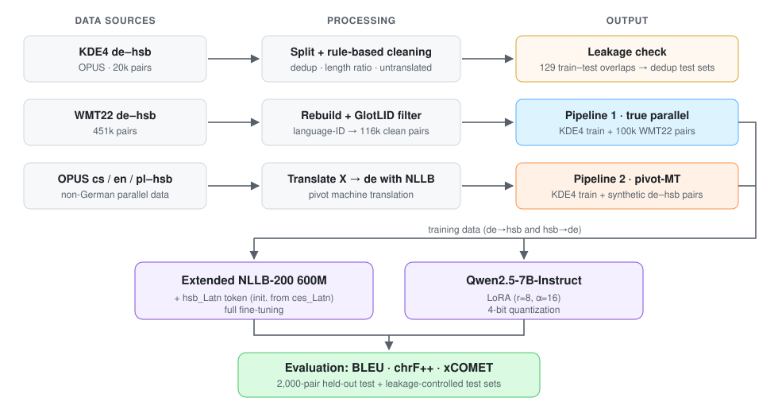

# Low-Resource MT for German ↔ Upper Sorbian

Fine-tuning **NLLB-200 (600M)** and **Qwen2.5-7B-Instruct + LoRA** for bidirectional machine translation between German (`de`) and Upper Sorbian (`hsb`), a West Slavic minority language of Germany with ~30k speakers that NLLB-200 does not support out of the box.

This repository contains my part of a three-person NLP course project at the **Technical University of Munich (Summer Semester 2026)**. The group studied low-resource MT across three language pairs. I led the **German ↔ Upper Sorbian** subproject and did the data collection, cleaning, language-ID filtering, pivot-MT data generation, all NLLB and Qwen experiments, and the test-set leakage analysis.

## Highlights

- **Extended NLLB-200 to a new language.** I added a `hsb_Latn` language token, resized the embedding matrix, and initialized the new token from the closely related Czech tag (`ces_Latn`).
- **Data quality first.** Rule-based cleaning of KDE4 removed 26% of pairs (duplicates, length-ratio outliers, untranslated copies). It raised DE→HSB from **24.4 to 45.6 chrF++**.
- **Found and controlled test-set leakage.** The KDE4 split contained 129 exact train–test pair overlaps. I built deduplicated test sets and re-ran the affected evaluations on them.
- **Language-ID filtering at scale.** I rebuilt the WMT22 DE–HSB bitext (451k pairs) and filtered it with [GlotLID](https://huggingface.co/cis-lmu/glotlid), which left 116k clean pairs.
- **Pivot-MT synthetic data.** I translated OPUS cs/en/pl–hsb corpora into German to create synthetic DE–HSB pairs. This gave the best DE→HSB result (**58.7 chrF++ / 40.5 BLEU**). It *hurt* HSB→DE, because machine-translated German on the source side does not match human references. Synthetic data is direction-dependent.
- **NLLB vs. LLM.** NLLB-600M beat Qwen2.5-7B+LoRA on chrF++ in both directions, despite having 12× fewer parameters.

## Results

The test set is the 2,000-pair held-out KDE4 split. Metrics are chrF++, BLEU ([sacreBLEU](https://github.com/mjpost/sacrebleu)) and [xCOMET](https://huggingface.co/Unbabel/XCOMET-XL), where available.

| Model / training data | Direction | chrF++ | BLEU | xCOMET |
|---|---|---:|---:|---:|
| Extended NLLB, zero-shot | DE→HSB | 23.5 | 9.2 | – |
| NLLB FT, original KDE4 | DE→HSB | 24.4 | 11.1 | – |
| Qwen2.5-7B + LoRA, original KDE4 | DE→HSB | 39.0 | 19.4 | – |
| NLLB FT, rule-cleaned KDE4 ¹ | DE→HSB | 45.6 | 30.8 | – |
| NLLB FT, KDE4 + WMT22-100k (GlotLID-filtered) | DE→HSB | 46.4 | 23.7 | 0.758 |
| **NLLB FT, KDE4 + OPUS pivot-MT** | **DE→HSB** | **58.7** | **40.5** | **0.783** |
| Extended NLLB, zero-shot | HSB→DE | 25.6 | 9.5 | 0.761 |
| **NLLB FT, original KDE4** | **HSB→DE** | **42.1** | 18.8 | 0.841 |
| Qwen2.5-7B + LoRA, original KDE4 | HSB→DE | 40.0 | **20.3** | **0.843** |
| NLLB FT, KDE4 + OPUS pivot-MT | HSB→DE | 33.2 | 6.9 | 0.804 |

¹ This result is on the cleaned test set. On the original test set the score is 39.8 chrF++.

The same results are in [`results/hsb_results.csv`](results/hsb_results.csv).

## Pipeline



## Repository layout

```
src/            Python scripts. Run them from inside src/; paths are relative (../data, ../models, ../outputs).
slurm/          SLURM job scripts used on the LRZ AI cluster (P100/A100 GPUs)
  data/         GlotLID filtering and pivot-MT translation jobs
  train/        NLLB and Qwen-LoRA training jobs
  eval/         BLEU/chrF++ and xCOMET evaluation jobs
data/           Data is not included; data/README.md explains how to download it
results/        Final result table
assets/         Figures used in this README
```

### Scripts by pipeline stage

| Stage | Scripts (`src/`) |
|---|---|
| Model extension | `extend_nllb_hsb.py`, `test_extended_nllb.py` |
| KDE4 splits and cleaning | `split_data.py`, `clean_parallel_data.py`, `split_cleaned_data.py` |
| Leakage control | `check_data_leakage.py`, `compare_original_cleaned_test.py`, `create_dedup_original_tests.py` |
| WMT22 + GlotLID (Pipeline 1) | `split_wmt22_tsv.py`, `rebuild_wmt22_parallel.py`, `check_wmt22_lid_quality.py`, `summarize_lid_report.py`, `filter_wmt22_by_lid_category.py`, `create_combined_train_with_original_devtest.py`, `create_combined_train_100k_wmt22.py` |
| Pivot-MT synthetic data (Pipeline 2) | `inventory_hsb_multilingual_sources.py`, `count_hsb_non_de_parallel_candidates.py`, `build_pipeline2_multilingual_source.py`, `translate_pipeline2_x_to_german.py`, `create_pipeline2_mt_de_splits.py` |
| Training | `train_nllb_finetune.py`, `train_qwen_lora.py` |
| Evaluation | `evaluate_extended_nllb_baseline.py`, `evaluate_qwen_baseline.py`, `evaluate_qwen_lora.py`, `evaluate_xcomet.py`, `summarize_xcomet_results.py`, `summarize_dedup_eval_results.py` |

## Reproducing

```bash
pip install -r requirements.txt

# 1. Download the data (see data/README.md), then build the splits
cd src
python split_data.py
python clean_parallel_data.py && python split_cleaned_data.py

# 2. Add the hsb_Latn token to NLLB-200-distilled-600M
python extend_nllb_hsb.py            # writes ../models/nllb-600M-hsb-init

# 3. Fine-tune and evaluate (use the SLURM scripts as the reference configs)
python train_nllb_finetune.py --direction de-hsb --split_dir ../data/splits_cleaned \
    --output_dir ../models/nllb-600M-de-hsb-cleaned
python evaluate_extended_nllb_baseline.py --direction de-hsb \
    --model_path ../models/nllb-600M-de-hsb-cleaned --num_test 2000
```

The SLURM scripts expect the repository at `$PROJECT_ROOT` (default `~/NLP-26SS`). Submit them from the repository root so that `logs/` resolves correctly:

```bash
mkdir -p logs && sbatch slurm/train/train_nllb_pipeline2_mt_de_51k_p100.sh
```

**Training setup:** NLLB was trained with full fine-tuning (5 epochs, lr 5e-5, effective batch size 16). Qwen2.5-7B was trained with LoRA (r=8, α=16, dropout 0.05, 4-bit quantization, 3 epochs, lr 2e-4).

## Limitations

- KDE4 is short UI-string text. The 2,000-pair test set is small, and the original split leaked 129 pairs, so absolute scores carry uncertainty.
- xCOMET is not natively trained on Upper Sorbian, so xCOMET scores for HSB output should be read with care.
- Model checkpoints are not released.

## Acknowledgements

This was a group project with Rauf Ibishov (English ↔ Azerbaijani) and Nicholas Nainggolan (Indonesian ↔ Batak Toba). The cross-language study code is at [raufibishov/mt-azerbaijani](https://github.com/raufibishov/mt-azerbaijani).

Data comes from [OPUS KDE4](https://opus.nlpl.eu/KDE4/corpus/version/KDE4) and the [WMT22 Unsupervised and Very Low Resource MT](https://www2.statmt.org/wmt22/unsup_and_very_low_res.html) shared task. The HSB extension approach follows *Adding Upper Sorbian to NLLB* (WMT 2024).

## License

The code is released under the [MIT License](LICENSE). The datasets are subject to their original licenses.
